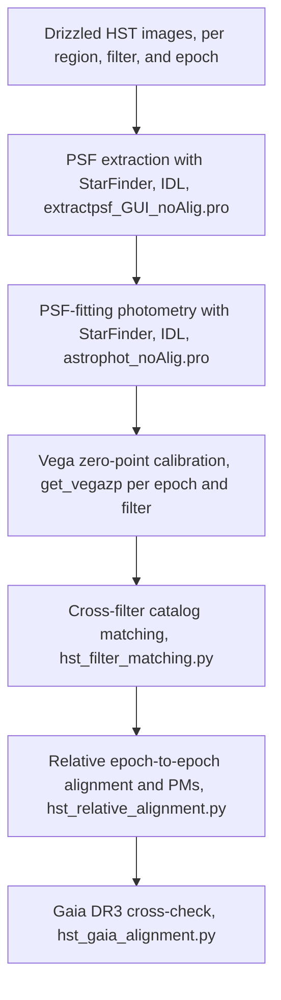

# HST Photometric and Astrometric Reduction for Proper-Motion Measurements

## 1. Overview

This document describes the photometric and astrometric reduction of multi-epoch HST near-infrared imaging, performed with the pipeline of the SOMA_HST_pms repository. The scientific objective is the measurement of stellar proper motions (PMs) in seven star-forming regions, by comparing two observation epochs per region separated by approximately seven to ten years. The pipeline proceeds in two stages: first, PSF photometry is performed on each drizzled image in each filter and epoch; second, the resulting source lists are astrometrically aligned between epochs (and, for validation, against Gaia DR3), from which proper motions are derived.

The pipeline combines IDL routines based on the StarFinder package with Python scripts based on Astropy, Astroquery, scikit-image (Polywarp), and AstroAlign.

## 2. Input Data

The input data are HST images in four filters of the WFC3/IR instrument:

| Filter | Band / line |
| --- | --- |
| F110W | J continuum |
| F128N | Paschen beta (Paβ) |
| F160W | H continuum |
| F164N | [Fe II] |

Each of the seven regions was observed at two epochs, with baselines of approximately seven to ten years. The starting products are drizzled (distortion- and cosmic-ray-corrected) images with a pixel scale of 0.12825 arcsec per pixel. The drizzled images are not aligned to Gaia; the corresponding routine versions carry the suffix noAlig. Working from the original (non-Gaia-aligned) frame preserves the distortion solution of the telescope and keeps the relative method independent of any external reference, which is the intent of the analysis. The seven regions are AFGL5180, G028.20-00.05, G032.03+00.05, G35.2-0.74N, G339.88-01.26, IRAS07299-1651, and IRAS16562-3959.

## 3. Pipeline Flow

## 4. PSF Extraction

The point spread function is extracted for every combination of region, filter, and epoch with the IDL routine extractpsf_GUI_noAlig.pro, which reproduces from the command line the PSF extraction performed by the StarFinder widget (XPsf_Extract session).

The routine reads the science extension of the drizzled image, estimates the background in a box of 21 pixels, and detects stellar sources with the StarFinder detection routine at a threshold of three times the background-subtracted image standard deviation. From the detections, isolated and non-saturated stars are selected (neighbours at least 5 magnitudes fainter within a radius of 10 pixels). The PSF is then constructed from these stars with the PSF_EXTRACT procedure, which yields a higher signal-to-noise PSF than the PSFMAKER alternative. The resulting PSF is stored per filter and epoch (psf_gui_<filter>.fits) and used as the empirical PSF in the subsequent photometry step.

## 5. PSF-Fitting Photometry

Source detection and photometry are performed with StarFinder through the IDL routine astrophot_noAlig.pro, executed for each region, filter, and epoch over the drizzled science image with the previously extracted PSF.

A noise map is constructed as the square root of the counts. The main StarFinder parameters are:

| Parameter | Value | Purpose |
| --- | --- | --- |
| Detection threshold | 0.5 sigma | Very low threshold to maximise completeness |
| Background box | 20 pixels | Local background estimation |
| Minimum correlation | 0.9 | Rejects spurious detections in bright diffuse emission |
| Correlation magnitude | 4 | PSF correlation saturation |
| Iterations | 2 | Successive source subtraction |
| Deblending | Disabled | Conservative source identification |

Each run produces a source list per region, filter, and epoch containing pixel positions (x, y), their formal uncertainties (sx, sy), fluxes (f), and flux uncertainties (sf).

## 6. Photometric Calibration

The calibration is performed in the Python stage with the dedicated routine get_vegazp (hst_irZP.py), which computes a VEGAMAG zeropoint of HST/WFC3-IR for a given observation date and filter, following the standard STScI procedure with synphot and stsynphot:

1. The bandpass is built for the observation mode wfc3,ir,band,mjd#MJD,aper#6.0. The observation date, read from the EXPSTART keyword of each image, enters the calculation explicitly, so the time-dependent sensitivity evolution of WFC3/IR is accounted for; the aperture of 6 arcsec corresponds to an effectively infinite aperture.
2. The inverse sensitivity (PHOTFLAM) is derived from the bandpass unit response, from which the STMAG and ABMAG zeropoints are also computed for reference.
3. The VEGAMAG zeropoint is obtained from the count rate of the CALSPEC Vega spectrum (alpha_lyr_stis_010.fits) integrated through the same bandpass, so that Vega has magnitude zero by construction.

The calibrated magnitudes and their uncertainties are then

m = -2.5 log10(f) + ZP,

dm = (2.5 / ln 10) * (sf / f).

Because the zeropoint is recomputed for every epoch and filter, the calibration fully accounts for the sensitivity decline of WFC3/IR across the seven-to-ten-year baselines.

## 7. Cross-Filter Catalog Matching

The per-filter source lists are combined with hst_filter_matching.py. For each region and epoch, the routine:

1. Converts pixel positions to celestial coordinates with the WCS of the drizzled image.
2. Calibrates the magnitudes of both filters as described above.
3. Projects both catalogs onto a common tangent plane (sky-offset frame centred on the field).
4. Cross-matches the two filters with a maximum separation of 80 milliarcseconds, keeping unique one-to-one matches only.
5. Fits a similarity transformation between the two filters' tangent-plane coordinate systems as a consistency check (translation and rotation are printed for inspection).
6. Writes a combined catalog (for example, H-J or H-Paβ) containing the calibrated magnitudes of both filters and the tangent-plane coordinates (xp, yp) referred to a single reference plane.

These matched lists, rather than the single-filter lists, are the input to the proper-motion stage, so that the astrometry benefits from the deeper continuum reference image while retaining colour information.

## 8. Relative Alignment and Proper Motions

The proper motions are computed with hst_relative_alignment.py, using epoch 1 as the reference frame. For each region and filter (by default F160W):

1. The matched source lists of the two epochs are loaded, calibrated, and filtered on the positional uncertainties.
2. All positions are projected onto the common tangent plane about the field centre.
3. The two epochs are cross-matched with a maximum separation of 50 milliarcseconds, retaining unique one-to-one matches; the epoch magnitude differences are inspected and sigma-clipped to reject outliers and strong photometric variables.
4. An initial similarity transformation between the two epochs is estimated with AstroAlign (find_transform, up to 100 control points); the reported rotation and translation serve as a first diagnostic of the epoch-to-epoch geometric offset.
5. The transformation is iteratively refined with the dedicated alignment routine alg_loop (alignator_looping.py). At each iteration, the two epoch catalogs are matched with a fine tolerance of 50 mas, matched pairs deviating in magnitude are removed by sigma clipping (rejection of mismatches and variables), and a polynomial warp (Polywarp) of the current degree is fitted, mapping epoch 2 onto epoch 1. The polynomial degree starts at 1 and is increased once the number of common stars has stopped growing and the per-degree loop limit is reached; with the adopted max_deg = 3, degrees 1 and 2 are used (the maximum fitted degree equals max_deg - 1). A weighted two-dimensional polynomial fit with iterative outlier removal is implemented as an alternative to Polywarp, as is the anchoring on a grid of bright, isolated reference stars (12 < H < 18, isolation radius 0.7 arcsec) to prevent the alignment being dominated by crowded regions; the grid is disabled in the default configuration.
6. The aligned epochs are re-matched within a maximum displacement of 150 milliarcseconds, and for every matched pair the proper motion is computed as the coordinate difference divided by the epoch baseline, both taken from the EXPSTART dates:

   mu_x = (x1 - x2) / dt,  mu_y = (y1 - y2) / dt.

7. The PM uncertainties are propagated from the positional uncertainties of the two epochs:

   dpm_x = sqrt(sx1^2 + sx2^2) / dt,  dpm_y = sqrt(sy1^2 + sy2^2) / dt.

8. A final quality cut retains stars with a combined positional uncertainty (sxy) below 0.5 arcsec. Note that the threshold value is defined in the script as a PM-error limit in mas/yr but is passed to the position-error argument of the filtering routine (see Section 11). The output catalog (pm_<zone>_<band>_posEpo1.txt) contains, for every star, both magnitudes, positions, proper motions, and their uncertainties.

In the regions where a sufficient number of Gaia stars is present, the relative PMs are compared directly with the Gaia DR3 proper motions of matched stars: the residuals in mu_x and mu_y show small dispersions, which indicates that the relative solution is not significantly affected by residual systematics.

## 9. Validation Against Gaia DR3

The Gaia-based verification is performed with hst_gaia_alignment.py in the regions with a sufficient density of Gaia detections. Its purpose is not to replace the relative PMs but to establish the quality of the relative method.

1. Gaia DR3 sources are retrieved with a cone search of 200 arcsec around each field.
2. Quality cuts are applied with the dedicated filtering routine (filters.py): five-parameter astrometric solutions (astrometric_params_solved = 31), non-duplicated sources, astrometric excess noise significance of at most 2, RUWE of at most 1.4, a deliberately permissive parallax-significance cut (parallax over error of at least -10, which retains field stars without significant parallax), a G-magnitude range of approximately 10 to 20, PM uncertainties of at most 0.3 to 0.5 mas/yr, and positional errors below 0.5 to 1 mas.
3. Gaia positions are propagated from the Gaia epoch (J2016.0) to each HST observation epoch using the Gaia proper motions, so that the comparison is performed at a common epoch.
4. Each HST epoch catalog is aligned independently to the propagated Gaia reference (similarity pre-transformation followed by an iterative, sigma-clipped polynomial refinement).
5. Proper motions are computed epoch-to-epoch in the Gaia frame, and the residuals between the resulting PMs and the Gaia PMs of the matched stars are examined.

The residual distributions between the Gaia PMs and the PMs from both methods present small sigmas. Since the Gaia-anchored solution is by construction tied to an absolute reference, this agreement demonstrates that the relative method introduces no significant systematic offset or extra dispersion, and validates the relative proper motions in the regions without Gaia coverage.

## 10. Data Products

The pipeline produces, per region and filter:

- Empirical PSFs per epoch and filter.
- Calibrated source lists per epoch and filter (positions, fluxes, magnitudes, and uncertainties).
- Cross-filter matched catalogs per epoch (two calibrated magnitudes and common tangent-plane coordinates).
- Proper-motion catalogs per region and filter, with PMs, PM uncertainties, magnitudes, and positions.
- Diagnostic plots at every stage: magnitude versus positional uncertainty, epoch magnitude differences, PM histograms, residual distributions against Gaia, and DS9 region files for visual inspection.

## 11. Notes and Points to Confirm

1. The sigma-clipping of the epoch magnitude difference in the relative alignment uses a very permissive threshold (30 sigma). Its purpose appears to be the rejection of gross outliers only; a stricter variability criterion may be advisable if photometric variables are a concern for the PM sample.
2. The noise map is taken as the square root of the counts rather than derived from the drizzled weight map. StarFinder positional errors are known (and noted in the code) to be overestimated; consequently, the formal PM uncertainties, which propagate these errors, are likely conservative.
3. In hst_relative_alignment.py, the final quality cut is invoked as filter_hst_data(max_e_pos = e_pm_cat) with e_pm_cat = 0.5 mas/yr. The threshold is therefore applied to the combined positional error (sxy < 0.5 arcsec) and not to the PM uncertainty. If the intention was to discard stars with PM uncertainties above 0.5 mas/yr, the argument max_e_pm should be used instead. Please verify which cut is intended.
4. The modules hst_irZP.py, alignator_looping.py, and filters.py have been reviewed. The remaining auxiliary modules (compare_lists.py, Polywarp.py, grid.py, ds9_region.py, cluster_finder.py) are imported from a separate local directory and are not part of the repository; their behaviour is inferred from their usage in the main scripts.
